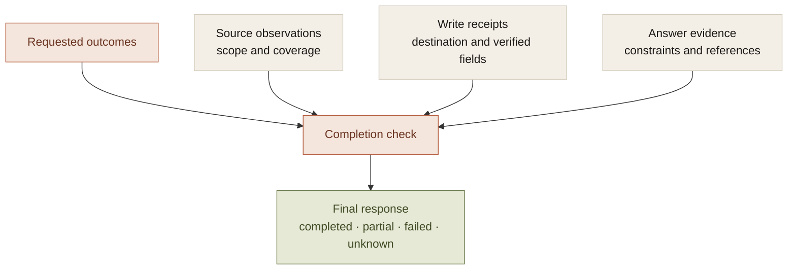
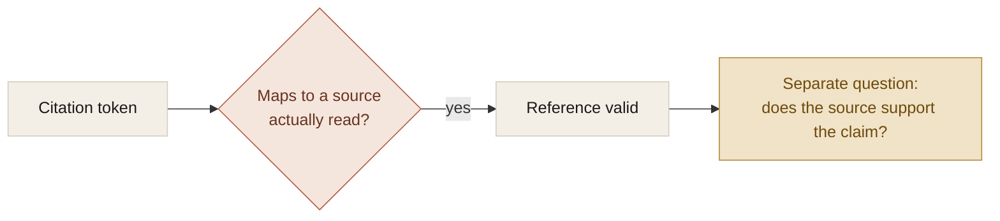

Agent systems often let the model decide when to stop and what to say about the result. That is reasonable for open-ended reasoning. It is insufficient as the only completion check for work with external effects.

The model can describe an action that never ran. A tool can succeed while the request remains incomplete. A citation can resolve to a real page without supporting the sentence beside it.

The completion layer needs to distinguish those cases. Its job is to connect evidence to the obligations in the task, rather than inherit the status of the most recent operation.

## What a receipt actually proves

A receipt has a verification scope.

For a supported reminder write, it can identify a destination object and confirm its requested fields. For a browser handoff, it may establish only that navigation was requested. For a shortcut, it may establish only a reported command outcome.

Treating all three as equivalent success gives the final answer permission to claim more than the executor knows.

The model can help assess semantic requirements. The controller can enforce concrete requirements such as the presence of a verified write receipt. Neither should silently claim to establish what the other has not checked.

## Outcomes must remain separate

A request to create a note, create a reminder, and explain a decision has several obligations. The note receipt satisfies one. It cannot hide the reminder or remove the requested explanation.

The companion's task contract records read, write, and answer outcomes with dependencies. Results are attached to the outcomes they satisfy. A task remains unfinished when a required effect lacks evidence, even if its latest tool returned success.

The contract is an interpretation of intent, so it can be incomplete. The original request and clarifications need to remain inspectable. An explicit wrong contract is not a correct task; it is at least a specific thing the person can correct.

This distinction is also useful for research. Opening a search tab is complete navigation. It is not complete comparison, and it should not unlock a dependent write merely because a browser operation succeeded.

## Read evidence needs a coverage contract

A returned list is not necessarily the complete source. A complete record list is not necessarily complete record content. An unknown total is not zero.

Useful observations retain:

- the resource and selection scope;
- when the observation was made;
- the records returned and the total when known;
- whether the result set is complete;
- whether individual contents were truncated.

Those fields let the controller reject an observation that cannot satisfy a required source read. They also give the answer a truthful basis for explaining limited coverage.

The interface does not need to expose every field. It does need to avoid turning bounded evidence into an unbounded claim.

## Citation validation is not factual entailment

The research controller can check that every citation refers to a page actually read. It can require sources for comparisons and reject malformed references. Those are useful structural checks.

They do not independently establish that every claim follows from the page. Multiple hosts do not establish source independence. The model's statement that coverage is complete does not independently verify that all user constraints were applied.

Naming that boundary matters. A status called verified can imply more than reference validation supplies. A useful evidence model says which check passed and leaves the remaining judgment visible.

## Final language should follow execution

A model can narrate success before a proposed tool has run. Streaming that narration immediately creates a completion claim the application may later have to contradict.

The companion withholds speculative tool narration and reconciles final output with retained outcomes and receipts. Missing or unknown writes cannot support a success claim. A task with verified partial progress can report that progress without claiming the whole request is complete.

This is the same architectural move as [putting refusal in the orchestration layer](/writing/refusal-is-the-feature): the system controls which claims it is prepared to return, using the evidence it actually has.

## What this leaves open

Mechanical completion checks do not eliminate semantic judgment. A written note can match the approved fields while containing a poor explanation. A comparison can cite real sources and still miss the important distinction.

The architecture should make those remaining questions easier to inspect, not hide them beneath a success label.

The useful output of a completion layer is a scoped account: these effects have receipts, these requirements remain open, and this uncertainty prevents continuation. That is a stronger foundation for trust than letting the model's final sentence be the only record that the job was done.
