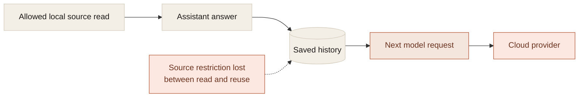
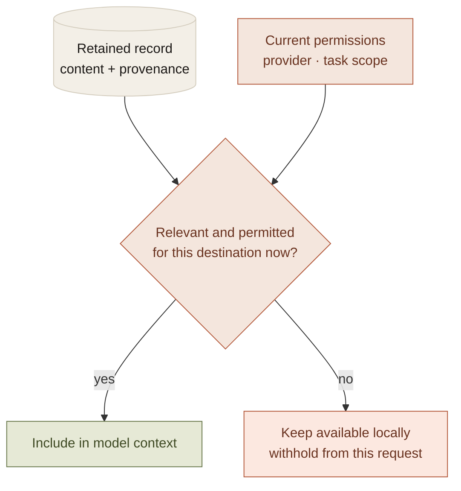

Most integration permission models focus on the initial read. The user allows Calendar, selects a folder, or enables browser context. The application checks that permission and retrieves the information.

Agent systems reuse the result. They summarize it, save it in a conversation, attach it to a task, and retrieve it later for another model turn.

If the restriction disappears during any of those transformations, the original permission gate no longer controls the whole path. History becomes an indirect disclosure channel.

This is why provenance has to participate in context assembly. Remembered information needs a source category and an eligible destination, not just a relevance score.

## The indirect path

Consider a local model that reads an allowed calendar event and mentions it in a saved answer. The user later selects a cloud model and continues the conversation.

The calendar integration did not make a cloud request. The next model call can still disclose calendar content if the saved answer is treated as unrestricted text.

That is a possible architecture failure, not evidence of an observed breach. Its importance is that the direct integration can be correct while the derived path is wrong.

The companion's provenance work carries source categories through included context, saved history, and proposed actions. Browser-derived evidence remains browser-derived when a task is reopened. The next request still has to respect the current sharing setting.

## Retention and disclosure are separate controls

A user can want a local record without wanting every future model to receive it.

The storage layer therefore answers whether the application retains a record. The context layer answers whether that record is eligible for this request, under the current provider and permissions.

Combining those decisions produces bad choices. Either useful history must be deleted to prevent sharing, or permission to retain history becomes an implicit grant to disclose it to a new destination.

The stronger design keeps the data-flow decision explicit:

The context can be useful to the person and ineligible for a particular model at the same time.

## Summarization is not declassification

A summary can be shorter than a source while revealing the same sensitive fact. A list of commitments is still calendar information even if it no longer resembles an event record.

A conservative rule is that derived context retains the relevant restrictions of its inputs unless a specific reviewed transformation justifies a different treatment. Compression alone is not that transformation.

This is not a complete semantic information-flow proof. Mixed-source summaries and inferred details are difficult. The point is to make the policy explicit rather than let a text transformation erase it accidentally.

Anthropic's [context-engineering discussion](https://www.anthropic.com/research/effective-context-engineering-for-ai-agents) describes maintaining useful context across inference turns. In a personal assistant, relevance is only one selection criterion. Source restrictions and the current destination have to be evaluated as well.

## Revocation has to reach saved work

Checking permissions only when a source is read leaves a gap for paused tasks. The journal may already contain the needed information, and resume may never call the source tool again.

The companion rechecks sharing before resuming saved work. A provider change or revoked source category can require a fresh request rather than silently carrying the journal into another model.

That can interrupt an otherwise convenient continuation. It is the expected consequence of making revocation meaningful. Saved progress does not grant permanent disclosure rights.

This also changes how to think about a model picker. Local versus cloud is a destination choice for context, not just a quality or latency preference.

## What this costs

Provenance has to travel with information across storage, summaries, context assembly, and recovery. Every new context producer becomes part of the policy surface. A string-only history representation is no longer sufficient.

There are also deletion semantics to explain. Clearing a conversation can remove local journals without removing a reminder already created in another application. Exported files and backups have their own lifetimes. Calling all of those memory does not make them one object.

The benefit is a system where retention, reuse, disclosure, and deletion can have distinct, truthful meanings. As assistants accumulate longer histories, that distinction becomes more important. A useful memory should not become a permanent exception to the user's current permissions.
