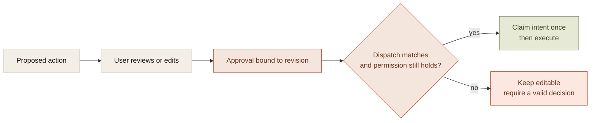

A Boolean named approved is too small to represent permission in an agent system.

Approved what? Which operation, against which destination, with which arguments? Does the approval cover the proposal before or after the user edited it? Can it be used twice? Does it remain valid after the underlying artifact changes?

Those questions are the approval model. The dialog is its interface.

If the model is implicit, the product can ask for confirmation repeatedly while still executing something different from what the person reviewed.

## The object being approved

An action approval needs to identify a bounded proposal. At minimum, that includes the task intent, operation, target, reviewed arguments or artifact revision, and the relevant authority scope.

For a reminder, the title and due time are part of the effect. For a code change, the relevant revision and target matter. Permission for an earlier proposal should not silently expand to cover a later one.

A simplified contract is:

```text
approval
  intent_id
  operation
  target
  reviewed_revision
  approved_arguments
  authority_scope
  consumption_state
```

This is a design sketch rather than a universal schema. The important property is that dispatch can compare the proposed effect with the reviewed one.



The check belongs where the effect can still be stopped. A valid approval screen does not eliminate the need for dispatch-time validation.

## Consent and provenance establish different things

An action field can come from the user's literal instruction, a source observation, a deterministic calculation, or an unverified model proposal.

Approval authorizes the reviewed value. It does not change where the value came from.

If the model guessed a reminder time and the user accepted it, the record can establish consent. It cannot truthfully relabel that time as extracted from Calendar. A successful executor receipt adds evidence that the value was written. It still does not prove the original interpretation was correct.

The companion preserves argument origins and edits for this reason. User literal, calculated field, approved proposal, and verified execution are related records with different meanings.

That distinction is useful during correction. A field derived from an event can retain its source record. A field changed in the approval sheet can retain its earlier value without pretending the change was present in the original request.

## The proposal must belong to the task

A schema-valid action can be unrelated to the user's goal.

The assistant's controlled probes produced unwanted reminder proposals after read-only work and failed prerequisite reads. An approval dialog alone does not solve that problem. It can simply present an irrelevant effect with a convincing explanation.

The task contract therefore constrains which outcomes may be pursued. A dependent write needs usable evidence for its prerequisite. A failed calendar read is not an event time, and an instruction-like sentence inside a source document does not authorize another action.

These checks reduce the burden on the person reviewing proposals. They do not solve arbitrary intent extraction. They make the application's interpretation explicit enough to constrain and correct.

## A waiting state needs a supported decision path

An early workspace hook marked arbitrary agent steps as requiring approval. The interface could only approve particular plan steps. Runs entered a waiting state with no usable continuation.

The defect was a mismatch between the execution state machine and the interaction model. Adding a block had not added an approval workflow.

The fix separated optional advisory signals from supported hard decisions. Mandatory authorization remained on the action path. Optional advice could no longer invent a waiting state the application could not resolve.

For every approval state, the implementation should be able to identify the decision owner, the exact proposal, the available choices, and the continuation each choice permits. Otherwise the product can look more governed while giving the user less control.

## Approval consumption is execution state

Repeated clicks, delayed callbacks, and restart recovery can all reach the same approved intent again.

For supported companion writes, the intent is durably claimed before dispatch. A repeated approval returns the saved task state instead of dispatching another copy. Invalid edits leave the sheet correctable rather than consuming a request that cannot run.

This is local coordination, not universal exactly-once execution. If a destination applies an effect and its response is lost, the outcome can still be unknown. A second click should not erase that uncertainty or authorize replay automatically.

The tradeoff is additional state and occasional reconciliation. The benefit is that approval means something precise after the interface disappears. The system can establish what was reviewed, what ran, and where those two records diverged.
