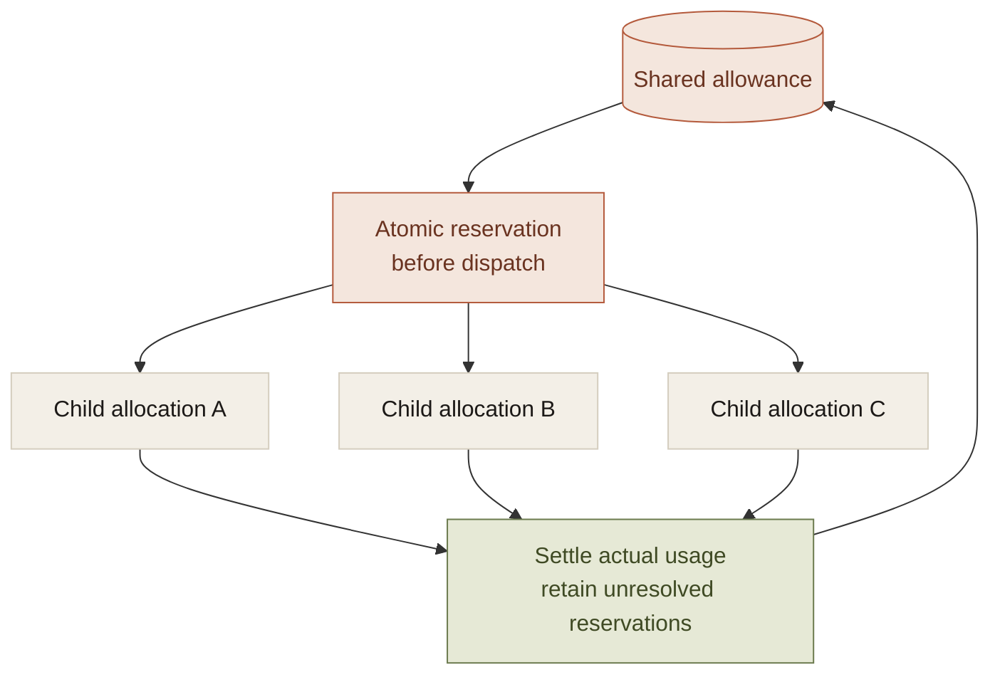
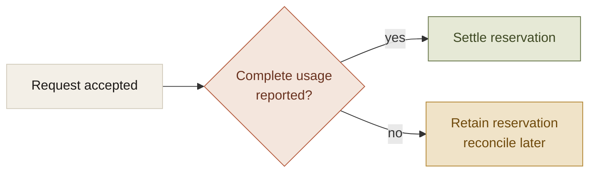

The usual way to limit an agent is to cap one request: maximum output tokens, a timeout, or a maximum number of turns.

Those are useful controls. They do not describe the whole task when the task can retry, spawn children, run tools, or submit external jobs.

Autonomy needs an aggregate contract. The system has to know which resources are available, which have been reserved, which were consumed, and which remain uncertain. Otherwise each component can obey its local limit while the overall task exceeds the user's agreement.

## A limit needs a unit and a scope

Several independent resources can grow:

- model requests and generated tokens;
- agent steps and repair attempts;
- delegated workers and recursion depth;
- tool calls, scans, and remote jobs;
- elapsed time and the user's attention.

The workspace harness bounded steps, per-category retries, fan-out, and depth. Each cap addressed a particular path through which work could multiply. No single one established the cost of every possible external operation.

That is the useful discipline: name the resource, name the scope, and put the check where the resource is committed.

## Delegation requires allocation

Suppose a parent has an illustrative twelve-dollar allowance and gives the same twelve-dollar allowance to each of three children. Every child can comply while their combined spend reaches thirty-six dollars.

The arithmetic is not a measured bill. It demonstrates that copying a limit is different from dividing an allowance.

A task-level budget needs shared reservations before dispatch:

The reservation has to be coordinated. If parallel workers can all read the same available amount before any reservation lands, the ledger describes the overrun after it happens instead of enforcing the boundary.

A bounded run tree alone does not provide that accounting. Hierarchical reservation is a design requirement I would add before claiming an aggregate delegated-spend guarantee.

## Retry policy is resource policy

A policy denial, rejected approval, unavailable runtime, and uncertain write should not share one retry loop.

A second attempt is useful only if it has a plausible chance of changing the outcome without violating authority or duplicating an effect. A denial does not become permission because the loop has iterations remaining.

The workspace classified failures before applying attempt limits and backoff. The companion separately allowed defined read recovery while blocking automatic retry of failed or unknown writes where the effect could be uncertain.

This turns retry from a generic resilience mechanism into a decision with a reason. The reason should remain visible beside the count.

## Unknown usage cannot be treated as zero

Provider responses can be incomplete after the provider has accepted work. A disconnected request may lack final usage data while still consuming resources.

The companion's accounting fix retains the reservation when complete usage is absent. Explicit zero usage and missing usage are different observations.

This is the resource version of an unknown external write. Missing confirmation does not establish absence. Automatically refunding incomplete responses makes the budget least conservative when its observation is least complete.

## Progress needs its own check

An agent can remain inside a resource limit and still waste work. It can reread the same source, regenerate the same invalid proposal, or continue planning after the requested effects are already verified.

For supported action-only companion tasks, completion from verified outcomes gives the controller a reason to stop. The model does not need to keep inventing activity after the task has evidence.

Open-ended investigation needs a less mechanical progress signal. It still benefits from explicit repetition limits and a defined transition to clarification, a changed approach, or a partial result.

The budget sets an outer boundary. Progress checks decide whether another iteration is worth spending inside it.

## What the user should be able to agree to

The interface can summarize a multidimensional contract as a useful scope: which work, which effects, how much resource use, and when another decision is required.

The user should not have to approve every token or child call. The execution system should be able to honor the larger agreement without treating every worker as a fresh source of permission and money.

This is the infrastructure cost of meaningful autonomy. An assistant that can choose more actions also needs an account of why it may continue choosing them. Otherwise a spending cap is a label in the interface, not a property of the run.
