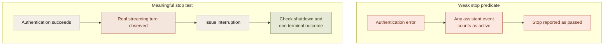

An agent evaluation is a program around another program. It has authentication, fixtures, transport, event parsing, scoring, and reporting. Any of those can be wrong.

That makes a clean pass rate less informative than it first appears. The system may have completed the task, or the test may have failed to reach the state in which failure was possible.

A useful evaluation has to establish its preconditions before interpreting its assertions. That is especially important for agent safety and lifecycle tests, where doing nothing can look like correct restraint.

## A stop test with nothing running

An early live runtime record reported a successful stop test even though the worker had not authenticated. The harness treated an authentication-error event labeled as assistant output as evidence that a streaming turn had started.

No useful streaming turn existed. The interruption result was invalid.

A separate restart result was weak for a related reason: a subsequent run produced no events. Failing to recall a sentinel did not prove safe history behavior if the worker had failed before meaningful recall could occur.

The defects were in the harness's interpretation of the run, not in the model's ability to perform the task.



The old record stayed invalid after the predicate was repaired. Later reruns supplied new evidence. Keeping those records separate prevents a convenient pass label from surviving after its meaning has been disproved.

## Negative assertions need positive controls

No forbidden tool ran can mean that the boundary worked. It can also mean that no tool could run at all.

A confinement test should establish a permitted path inside the intended boundary. A revocation test should establish that the capability was available before revocation. An interruption test should establish active work before stopping it.

These positive controls make the negative result interpretable. They do not turn one prompt into a universal guarantee. They establish that the test exercised the property it names under the recorded conditions.

A minimal interruption sequence is:

```text
confirm authentication
observe a real active turn
request interruption
observe controlled worker termination
assert one terminal outcome
assert no subsequent governed dispatch
```

A generic assistant event is not a substitute for the second line.

## Certify the answer key too

The earlier SQL evaluation ran canonical queries against the real engine on controlled fixtures before comparing generated results. That tested the expected answers rather than assuming they were correct.

The comparison contract also matters. Row order, duplicate rows, numeric tolerance, and date representation can each turn a correct result into an apparent failure or an incorrect result into a pass.

An end-to-end Python evaluation exposed a different boundary: dates were serialized into internal representations that SQL checks had not exercised. That is a useful reminder that component correctness does not establish agreement between components.

The evaluation should follow the path whose behavior it claims to measure.

## Keep the evidence layers distinct

There are three different kinds of evidence in the companion's evaluation approach.

**Controller fixtures.** Real controller logic receives synthetic observations and receipts. These can test approval consumption, unknown-write blocking, cancellation transitions, and completion checks.

**Live model probes.** A tested model receives controlled requests and evidence. These can measure tool and argument selection for those cases, without necessarily dispatching real effects.

**Controlled device journeys.** The actual application performs supported operations against disposable destination records. The resulting state is read back and compared with the request and approved fields.

Passing one layer does not certify the others. A synthetic receipt cannot prove a real Calendar write. A correct model proposal does not prove restart recovery. A successful app write does not establish interpretation quality across arbitrary requests.

## Report failure categories instead of hiding them in one score

Task success, false success, unintended effects, duplicate writes, human intervention, and latency describe different product properties.

A correctly handled injected failure can pass its scenario without completing the requested task. A model can select the right tool and use the wrong deadline. A final answer can sound correct while its destination receipt is missing.

Collapsing those cases into one rate removes the information needed to decide what to fix next.

The evaluator should produce a trace from result to diagnosis: which prerequisite existed, which boundary was exercised, which assertion failed, and what evidence supports the classification. That is what makes an evaluation useful after the model, provider, or operating system changes.
