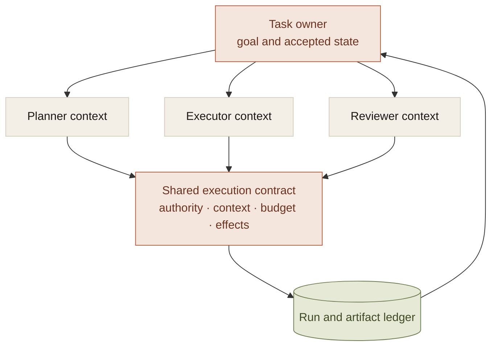
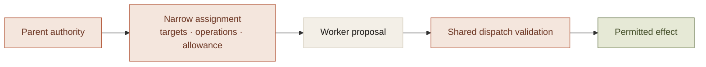

The usual multi-agent diagram divides reasoning into roles: planner, researcher, executor, reviewer. Each role sounds sensible. The diagram says little about the state they share.

Which revision is accepted? Who owns an approval? Can the reviewer authorize a fix? Which worker may write a file? Does each child inherit the entire budget? Who establishes that the task is complete?

Those questions belong to the execution model. Adding agents before answering them distributes uncertainty across more conversations.

A useful division is separate reasoning contexts over one authoritative account of the work.

## A role is a composition of capabilities

The workspace's kernel decision defined roles through instructions, tools, policies, capabilities, and expected artifact targets. Planning, execution selection, authority, context controls, and persistence belonged to the common substrate.

The motivation was concrete. Runtime profile had been used for both reasoning configuration and compute destination, and different entry points could resolve execution independently. Another specialist backend would have added another path through that ambiguity.

The accepted design had an initial implementation; it was not evidence that every legacy path had already converged. It established the direction in which new roles had to fit.

The roles can see different evidence and produce different outputs. They should not invent independent meanings of approved, executed, or complete.

## Define the return contract before spawning

A summary, a code revision, a test result, and a review finding need different merge rules.

A code contribution needs a base revision and an allowed write scope. A test result needs to identify the artifact it exercised. A research contribution needs inspectable evidence. A reviewer finding identifies a problem; it does not grant permission to perform the fix.

The parent needs a criterion for accepting each contribution. Without it, the merge becomes another generation step comparing several confident accounts of progress.

Anthropic's [agent-pattern discussion](https://www.anthropic.com/research/building-effective-agents) includes parallelization and orchestrator-worker arrangements. The relevant question is whether a particular task has a division whose results can be combined under a clear contract. A role list alone does not establish that division.

This is also where the overhead becomes visible. More contexts mean more initialization, communication, evidence selection, and reconciliation before the system changes anything useful.

## Delegated authority should narrow

The reviewer inspecting a file does not automatically need the executor's mutation rights. A worker investigating a dependency does not need authority to deploy the final artifact.

The assignment should identify the resources, operations, context, and budget it permits. Dispatch should enforce those bounds. A prompt that calls a worker read-only is not sufficient if its tool path can still write.

This is a design requirement, not a claim that every project version already enforced a complete delegated capability system. The important architectural property is that creating another worker cannot create more authority than the task possesses.

The same rule applies to budgets. A child receives an allocation from shared capacity, not a fresh copy of the parent's whole allowance.

## Disagreement needs a resolution policy

Two workers can produce incompatible conclusions. Another round is useful if it supplies new evidence, tests a disputed assumption, or asks the person for a decision the system cannot make.

Repeated review without a new information source can become an expensive cycle. A repair limit and a durable unresolved finding are more honest than indefinite coordination.

The shared task record should retain which contribution was accepted, the revision it refers to, and which obligations remain. That is what lets a later model explain the outcome without reconstructing it from several transcripts.

A new reasoning context can improve independence. It does not remove the need for an authoritative state transition when a suggestion becomes an accepted change.

## When another agent is worth it

Separate contexts can be useful for independent investigations, bounded parallel work, or reviews where inheriting the writer's entire reasoning would be undesirable. They are less attractive when workers repeatedly wait on one another or mutate the same state without clear ownership.

The tradeoff is task-specific: improved reasoning or latency against the cost of coordination and context duplication. It should be measured at the level of the completed task.

The user should see one coherent account of the requested outcome, the contributions, the decisions, and the result. They should not have to reconcile the agents' organizational chart themselves.

A multi-agent system becomes dependable when specialized reasoning fits inside a shared execution model. The number of participants is downstream of that decision.
