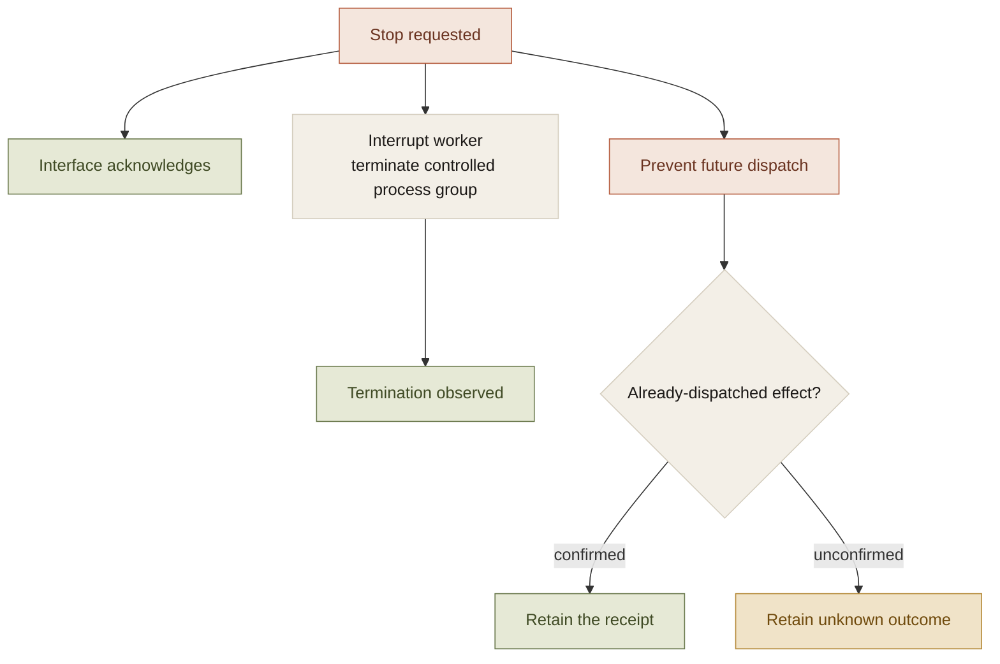
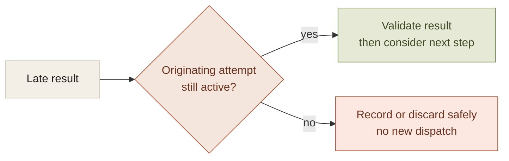

There is a common shortcut in agent interfaces: Stop means stop displaying the response. The text stops, the spinner disappears, and the task looks cancelled.

That says little about the execution underneath it.

The worker may still be running. A tool call may already be in flight. A late result may still trigger the next step. An external application may have applied a write whose receipt has not arrived.

Cancellation needs to be part of the execution protocol. Otherwise the interface and the system can disagree about whether the agent is still allowed to act.

## Three boundaries, three meanings of stopped

**Acknowledgement.** The application received the user's decision and reflected it promptly.

**Termination.** The processes and waits under the application's control have stopped, or have reached a defined shutdown bound.

**Effect state.** The system knows which external operations completed, which did not, and which remain unknown.

One number cannot stand in for all three. A fast acknowledgement is useful responsiveness evidence. It is not proof that a process group has exited or that a dispatched write had no effect.

The run's terminal state has to account for all of those paths. Removing the streaming text is only the first one.

## Cancellation has to reach the waits

Checking a cancel flag between model turns works only if control returns to that check.

Agent execution waits in several places: a queue, worker startup, a blocked input write, a response read, a tool operation, a provider stream. A cancellation protocol has to define what happens at each wait.

The companion's blocked-worker tests made this concrete. A local worker that was not reading input could leave the controller waiting despite an outer cancellation flag. Queue waits, startup, writes, and reads had to observe cancellation themselves.

For external runtimes, process-group shutdown mattered as well. A child can ignore graceful termination or outlive the immediate process. Tests included resistant children and races between stop and normal completion.

Those tests establish behavior for the controlled paths and tested runtimes. They do not establish an unrestricted operating-system fence around every possible vendor effect. The scope of the cancellation promise needs to match the scope of control.

## Late output must not regain authority

A cancelled operation can still return information. That information belongs to the old attempt. It must not automatically advance the task.

This is an execution rule, not a prompt convention. The controller needs to associate callbacks and streamed events with the attempt that produced them and check that attempt's state before allowing another effect.

The same rule applies to fallbacks. Cancellation of browser research should not be interpreted as an ordinary read failure that starts another search route. An alternative route is future work; the user just stopped future work.

Voice introduces another surface for the same problem. Queued speech can be replaced or cancelled. Speech already played cannot be withdrawn. Completion language should therefore wait for the evidence it claims to describe.

## Stop does not imply rollback

A completed external effect remains completed after cancellation. An unconfirmed effect remains uncertain.

Treating either as absent can cause a duplicate write on recovery. Treating cancellation as automatic compensation can cause a different unauthorized effect. Undo needs its own supported operation and authority.

The companion preserves verified receipts and blocks automatic replay of unknown writes. Subsequent work that depends on an unresolved effect stops too. That is less tidy than a single cancelled label, but it describes the destination state honestly.

## Terminal states need to survive restart

An interrupted task and a cancelled task may both end with unfinished steps. They should not have the same recovery behavior.

An interrupted read may be retried under its policy. A pending approval may be restored. An unknown write needs reconciliation. An explicit cancellation keeps future steps stopped.

Persisting those distinctions is what prevents a restart from reviving work the user already ended. It also makes stop-versus-completion races testable: one attempt should produce one terminal outcome, not a cancellation followed by a later success that overwrites it.

The cost is lifecycle machinery across the whole stack. The benefit is a control the user can rely on without knowing which process currently holds the task. For an agent that can act, that is part of the basic execution contract.
