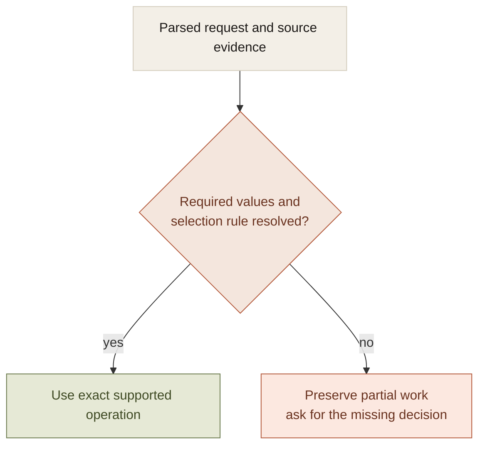

A personal assistant sits between ambiguous language and exact systems.

The request can be casual. The reminder still has a specific due time. The note still has a literal title and body. The calendar event still has an identity, a date, and an offset. The destination app does not execute the general feeling of what the user meant.

That makes a useful assistant a combination of language interpretation and constrained execution. The model can translate intent into a proposal. The surrounding system has to preserve the details that stop being negotiable once the intent is clear.

## The boundary becomes visible in ordinary work

One controlled companion probe selected Calendar correctly and then proposed a reminder at 12:30 instead of the required 08:30, omitting the source event's identity. No app effect was dispatched.

The selected tool was right. The derived arguments were wrong.

That distinction is easy to miss in a tool-selection benchmark and difficult to ignore in a reminder. It also explains why adding more integrations is not sufficient progress. Each integration needs a contract for how its observations become the next action's inputs.

For a supported event-preparation request, the chain includes source scope, event selection, time arithmetic, approval, and write verification. All of them participate in correctness.

## Keep exact operations exact

Once the selected event and lead time are established, subtracting a duration is a deterministic operation. A second model turn does not need to rediscover the arithmetic.

A meeting at `10:00+02:00` with a thirty-minute lead produces `09:30+02:00`. Retaining the offset and source identity matters as much as computing thirty minutes. The value is not an unqualified 09:30 in whichever time zone a later component assumes.

The calculation above is illustrative. The architecture property is that the derived value retains its inputs and meaning through approval and execution.

The same principle applies to literal content. A quoted note body should not absorb a following reminder clause. An exact requested title should not be rewritten to sound more natural. These are data-preservation rules at the edge of language understanding.

## Narrow deterministic routes need honest limits

The companion supports a specific first-event preparation form: an explicit date and one supported minute or hour lead time. Ambiguous, partial, tied, all-day, malformed, or unsupported selections pause.

That is a meaningful capability because its conditions are stated. It is not a claim to understand arbitrary scheduling language.

A narrow parser becomes dangerous when the product silently treats a partial match as full understanding. Unsupported wording needs clarification or another supported route. It should not be squeezed through a grammar that has already lost an important constraint.

The point is to constrain the unresolved part without asking the person to repeat everything already established.

## Personality and task state are different layers

A companion can be warm, expressive, and quiet. Its task state still needs precise meanings.

Waiting for a date, waiting for approval, saved, failed, and unknown describe different execution conditions. Conversational language should express those conditions rather than smooth them into the same reassuring response.

This matters because completion transfers attention. A person told that a reminder exists may stop remembering to create it. The assistant's final sentence is part of the functional behavior, not just a stylistic flourish.

The controller should therefore derive completion from retained evidence and prevent speculative success narration from preceding the tool result.

## Proactivity requires a host and a scope

Morning briefs, saved searches, and monitors extend the same requirements over time. They need an approved recurring scope, a schedule, a responsible executor, retained results, and a delivery policy.

A saved due time is not an executor. A local task cannot promise continuous progress while its process is quit unless another execution host exists. Recovery of overdue work is a different promise from on-time delivery.

The interface should also distinguish a meaningful change from an unchanged check. A monitoring agreement is useful when it protects attention, not when every interval creates another unnecessary update.

## The acceptance test should cross the whole boundary

A correct proposal is only part of an assistant workflow. The useful journey includes an edit, a cancellation, an approval, the destination effect, and its readback. Recovery needs a separate check after dispatch and before confirmation.

Controller fixtures can establish state-machine behavior with synthetic evidence. Live model probes can expose argument and routing failures. Real destination acceptance needs controlled records on the actual device.

A personal assistant earns breadth by preserving those distinctions across increasingly useful tasks. The architecture should be judged by the reliability of the everyday promise, not the number of app names in the integration picker.
