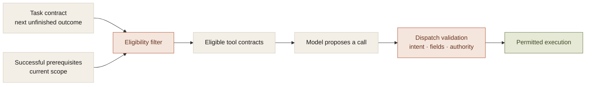

A tool catalog tells you what an agent could call. It does not tell you what the agent should be able to call in the current task state.

The distinction becomes visible when a failed source read is followed by a write that depended on that source. The model can produce valid arguments for an action the application has no evidence to justify.

Adding another sentence to the tool description can help selection. It does not make the prerequisite exist. The tool interface needs a contract the controller can evaluate before the next model turn and again before execution.

## A schema is one part of a contract

A useful tool contract describes several things:

- **Input shape.** Required fields, allowed values, and their types.
- **Eligibility.** Which task outcome and successful prerequisites permit this call.
- **Effect scope.** What resources the operation reads or changes.
- **Result meaning.** What a successful return actually establishes.
- **Recovery.** Whether failure or uncertainty permits a retry.

The companion's tool definitions carry routing and verification information beyond their public argument schemas. That lets the controller narrow eligible tools while giving the model an accurate account of the remaining choices.

The two views should agree. A model-facing description cannot be the sole authority, and a dispatcher should not implement an undocumented interpretation that the model has to discover through repeated errors.

## Selection and execution need different checks

Selection asks which tools are relevant and eligible for the next unfinished outcome. Dispatch asks whether this particular call may happen now.

The first check removes choices that should not be offered. The second catches stale proposals, permission changes, and adapter mistakes that could have widened the model-facing schema.

This is a useful division because the failure modes differ. An irrelevant proposal is a selection problem. A correctly selected operation with changed arguments is a dispatch problem. They should not be hidden behind one tool-call success rate.

## Failed prerequisites change the action space

A reminder based on a calendar event needs usable event evidence. A permission error does not supply a time. A malformed response does not establish an empty calendar. A partial observation may not support a claim about the whole day.

The controller can make the dependent write ineligible until those conditions are satisfied. It can offer a bounded read recovery or request missing information instead.

This is stronger than returning the error as ordinary text and leaving the full catalog available. The application knows the prerequisite failed; it should use that fact structurally.

In the companion's controlled probes, unwanted reminder proposals after failed reads and read-only work made that need concrete. The resulting guards have a defined scope. They constrain the saved task interpretation; they do not prove that arbitrary human intent was understood correctly.

## Determinism belongs at the settled edges

An explicit timer duration or a supported calculation from a typed timestamp does not need an unconstrained planning loop.

The companion uses narrow deterministic routes for supported forms. Literal titles and bodies remain literal. A derived calendar deadline can retain the source event and checked arithmetic. Missing or ambiguous inputs stay unresolved.

The limit must be honest. A narrow binder should not silently extend itself to unsupported phrasing. Clarification or another supported path is preferable to a plausible action assembled from an incomplete parse.

The architecture can combine deterministic operations with model interpretation. The goal is to spend flexibility where the task needs it and preserve exactness where the semantics are already settled.

## Capabilities need end-to-end meaning

The earlier workspace's router used an exhaustive capability-to-lane mapping. Adding a capability without a route could fail at compile time rather than fall into an unrelated default.

That prevents a routing omission. It does not prove the new capability runs. The rest of the path still needs a runtime, valid prerequisites, an executor, and a result contract.

A browser tool illustrates the distinction. Opening a page, reading its relevant contents, and satisfying a research request are different capabilities. A handoff receipt for the first cannot establish the third.

The same applies to generated artifacts. Producing a pipeline definition does not establish that its sink was written. A supported claim should be attached to the stage the implementation actually exercises.

## The tradeoff

Richer tool contracts create maintenance work. Adding an operation requires decisions about eligibility, effects, evidence, and recovery. Provider adapters have to preserve restrictions instead of restoring broader schemas.

That is useful friction. It makes the cost of a capability visible before the product advertises it.

For an agent, the tool interface is part of the operating environment. Accurate contracts reduce the amount of reality the model has to infer, and dispatch keeps the parts that must be enforced outside inference altogether.
