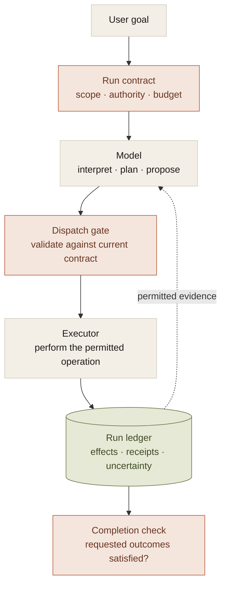
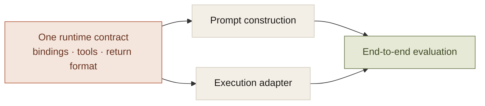

The usual diagram of an agent is a loop. The model receives a goal, chooses a tool, reads the result, and chooses another tool. Repeat until done.

That is a reasonable description of how reasoning progresses. It leaves out most of what makes the system dependable.

Who decides which data the model may see? What happens when a tool times out after applying a change? Does a restarted run retain the same budget? Can a different model resume without repeating an approved action? What makes done more than a sentence the model generated?

Those are harness questions. They remain even if the model gets substantially better.

## What the model supplies

A model contributes interpretation, planning, generation, and adaptation. Given the available evidence, it proposes what to do next. That flexibility is the reason to put it in the system.

It does not follow that the model should own the conditions under which its proposal becomes an effect.

A model's judgment that an action is useful does not authorize it. A statement that a tool ran does not establish that it ran. A decision to retry does not establish that the previous attempt had no effect.

The architecture needs a place where those distinctions are enforced. The useful boundary is between **proposing work** and **owning its execution**.

The model is inside the loop. The contract and the ledger give the loop boundaries that survive a model turn.

## Six concerns that should not share one setting

One of the architectural problems in the data workspace was that runtime profile meant two different things: a reasoning configuration and a compute destination. Different paths could resolve execution independently.

The replacement contract separated six axes:

1. **Agent.** Which reasoning runtime, model, and transport are used.
2. **Execution.** Where computation runs: local, on-premises, or cloud.
3. **Authority.** Which operations are allowed and where approval is required.
4. **Context.** Which information may enter the reasoning process.
5. **Capabilities.** Which tools and role-specific operations are available.
6. **Artifacts.** Which durable outputs the task is expected to produce.

These choices interact, but they are not interchangeable. Switching to a cloud model should not automatically move execution to a cloud account. Allowing a source read should not automatically allow disclosure to every provider. Adding a specialist should not create an independent approval system.

Separating the axes makes those changes explicit. It also makes a run record useful after the workspace defaults change. A resumed task needs its execution context, not an accidental reconstruction from today's settings.

## The runtime contract is part of the prompt

The most direct evidence for this came from a Python-generation evaluation.

The prompt described DataFrames named `step_<N>_df` and told the model to print the answer. The runner supplied `load_table(...)` and a primary `df`, then read the answer from a `result` variable.

The prompt and the executor described different environments.

On the recorded fifteen-case synthetic ecommerce suite, the Python path passed one case initially, thirteen after the runtime contract was corrected, and fifteen after date serialization was repaired. The model was held fixed. Those counts describe that small historical suite, not general Python accuracy.

The lesson was more useful than the score. A model can follow the instructions it receives and fail because the application supplied the wrong instructions. The harness has to keep the model-facing contract aligned with the actual environment.

A shared description reduces drift. An execution test establishes that the description is true. Both are necessary; a single wrong contract can otherwise distribute the same mistake consistently.

## What belongs outside the model turn

The durable state should include the task, approved scope, consumed budget, attempted effects, retained receipts, and unresolved outcomes. These records cannot depend on the next generated response remembering them correctly.

The model can help decide whether a result is useful. The controller can establish whether a required receipt exists. The model can suggest a retry. The execution layer can establish whether the operation is repeatable. The model can request more context. The context layer can decide whether the current provider may receive it.

That division does not make the system fully deterministic. It puts deterministic checks where the relevant facts are available and lets the model reason within them.

It also exposes what remains uncertain. A correct schema does not prove correct intent. A successful tool does not prove a finished task. A citation that resolves does not prove that every sentence follows from its source.

## The cost of owning the harness

A real harness is more expensive than a prompt and a tool list. It needs state transitions, versioned contracts, provider adapters, failure classification, and tests that exercise interruption and recovery. The implementation has to reconcile several things that a chat-only application can leave implicit.

That cost is not justified for every request. A one-shot summary may need only one model call and an appropriate disclosure policy. Work that mutates external state, survives interruption, or delegates to other workers needs more of the machinery.

The decision is about the promise the product makes. If the promise is that the system will carry a piece of work to a verifiable outcome, the harness is part of the product's core. It cannot remain incidental glue around a model API.
