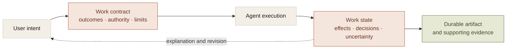
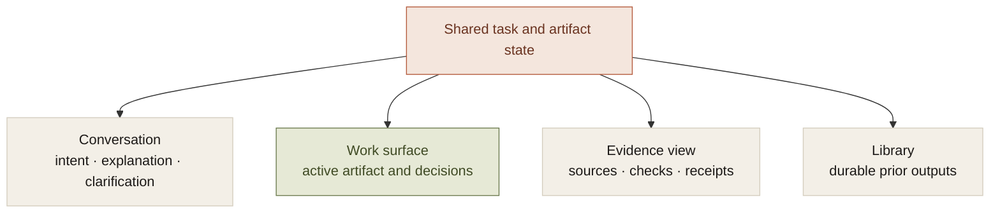

I think the useful shift in AI products is from generating an answer to carrying responsibility for a bounded piece of work.

That changes the interface problem. An answer can live in a message. Work has inputs, permissions, intermediate effects, unresolved decisions, and a result that may outlive the conversation.

A longer context window can help the model reason about that work. It does not establish its authoritative state. The product needs an explicit agreement about the outcome, what may be done to reach it, and what will count as completion.

That agreement is the work contract. My bet is that it becomes a more important product surface as people delegate longer tasks.

## The contract underneath the conversation

A useful work contract contains several kinds of information:

- **Outcome.** What the user wants produced or changed.
- **Constraints.** Requirements the result and process must preserve.
- **Authority.** Resources, operations, and decisions available to the agent.
- **Allowance.** Time, spending, and execution bounds.
- **Evidence.** How completed effects and claims will be established.
- **Remaining work.** Obligations, approvals, and uncertainty that prevent completion.

A conversational interface can help create and revise that agreement. It should not be the only place where the agreement exists.

The model can change its approach while the system preserves the agreed boundaries. A revised goal or materially different effect can require a revised contract rather than silently inheriting old permission.

## Artifacts and evidence need different places

One symptom in the workspace was the same answer appearing in as many as four regions: the center document, recent-answer strip, right-hand card, and right-hand prose. The regions were all views of a shared conversation, so each reproduced the same output.

The redesign assigned ownership. The center held the active artifact. The rail held evidence about that artifact. The library held prior outputs. Some deeper per-producer run isolation remained deferred; presentation changes could not supply missing execution identity.

That is a broader interface lesson. Decide what a surface produces or explains before adding another panel.

The diagram is an interface model, not a shipped-feature claim. The useful property is that different views agree on the same work instead of inventing their own version of it.

## Human attention should follow unresolved decisions

An agent that asks for approval repeatedly can consume more attention than it saves. An agent that hides changed assumptions can consume authority the person did not grant.

The contract gives the system a way to distinguish those cases. An unchanged approved detail remains settled. A different revision or expanded scope becomes a meaningful decision. An unknown write needs reconciliation rather than another generic Continue button.

This is why I expect a single autonomy slider to be insufficient for serious work. Data access, external effects, spending, and interruption are independent choices. Different tasks need different combinations.

The interface can summarize those choices without making the user operate a policy engine. It still needs an execution model precise enough to honor the summary.

## Longer task horizons do not remove the infrastructure

METR's [task-completion time-horizon work](https://metr.org/time-horizons/) estimates success at specified reliability levels on tasks measured by human completion time. The software-focused suite is not a direct measure of uninterrupted safe operation by a personal assistant.

Benchmark progress can justify attempting more ambitious tasks. It does not establish whether a product preserves approvals after restart, reconciles external effects, or continues executing while a desktop process is quit.

Those are separate promises with separate evidence. Better models can reduce interpretation and planning failures while leaving the product responsible for authority, continuity, and delivery.

## The durable product boundary

The user's work should retain a coherent identity through model changes. Completed effects should remain completed. A spending limit should not reset. Source restrictions should not disappear when context becomes history. A useful artifact should remain inspectable after the original conversation is no longer relevant.

This is where I would put the durable boundary: the product owns the contract and the work record; models supply reasoning within it.

The cost is more state and more explicit recovery than a chat wrapper requires. The gain is a system the person can return to and understand: what happened, what remains, what needs a decision, and what evidence supports the result.

That is the direction I am interested in building toward. Intelligence makes more work possible. A dependable work contract makes that possibility something a person can delegate.
