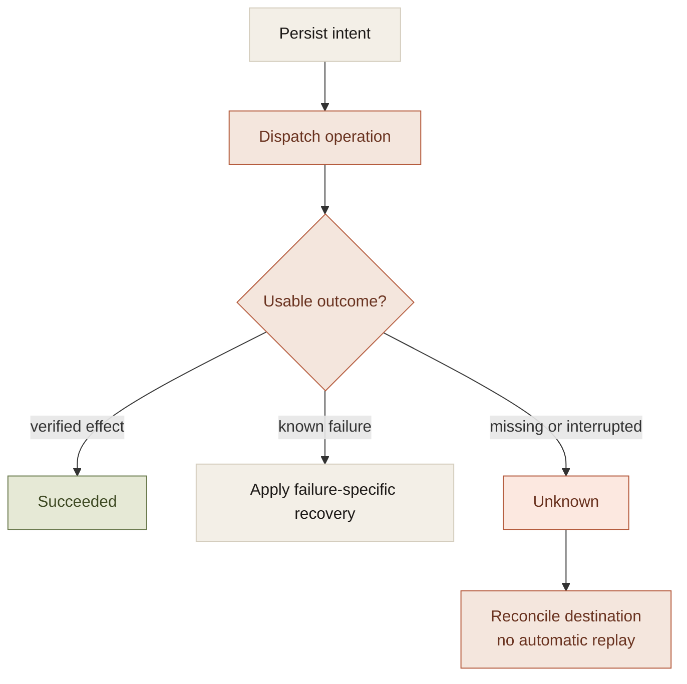

The default answer to agent continuity is to save the conversation and put it back into context on the next run.

That preserves the discussion. It does not establish the execution state.

A request can leave the application, change something elsewhere, and lose its response before the receipt is saved. The conversation contains the intention to act and no confirmed result. Neither retry nor success is justified by that record alone.

Recovery starts by representing the missing information correctly. An uncertain effect is a state of the system, not a gap for the model to fill with a plausible explanation.

## The state the transcript cannot supply

There are at least three outcomes after dispatch:

- **Succeeded.** The supported verification has confirmed the intended effect.
- **Failed.** The operation failed, with enough information to apply its recovery policy.
- **Unknown.** The application cannot establish whether the effect occurred.

Unknown cannot be collapsed into failed. Doing so makes automatic retry available exactly when retry may duplicate an action. It cannot be collapsed into succeeded either. That creates a completion claim without evidence.



A local journal cannot invent a missing external receipt. Its job is to keep the uncertainty intact until a supported reconciliation path can resolve it.

## Task and conversation are different objects

A conversation groups related turns. A task owns the obligations arising from a request. One conversation can contain several tasks, and one task can cross several turns and approvals.

The distinction matters for a request that creates a note and a reminder. A verified note receipt satisfies one outcome. The reminder can remain pending. Reopening another conversation must not move that approval into a new thread or cause the completed note to be created again.

The companion's design separates conversation membership from the task journal. The journal retains requested outcomes, dependencies, inputs, approvals, observations, and receipts. Membership associates that work with the right conversation.

That is a small database design with a large behavioral consequence: the assistant resumes from recorded obligations rather than asking a model to reconstruct progress from dialogue.

The interpretation of the request can still be wrong. The task contract must therefore be inspectable and correctable. Durable state makes an interpretation stable; it does not make it accurate.

## Recovery should preserve effects and recheck authority

Completed work and future permission have different lifetimes.

An action completed yesterday remains part of the record. The permission to perform the next action may have changed. The user may revoke an integration, switch models, or edit the pending proposal.

A resume path needs both the saved execution state and current authorization. Reusing a receipt does not require repeating the action. Reusing private source context with another provider requires checking the new destination's sharing policy.

A useful recovery record looks closer to this than to a transcript excerpt:

```text
task
  requested outcomes
  completed outcomes and receipts
  pending proposal and reviewed revision
  unresolved effects
  original execution context
  current eligibility to continue
```

The last item is deliberately current. Persistence must not become a way to bypass revocation.

## Different interruptions need different continuations

A pending approval can restore its exact fields. An interrupted read may be eligible for a bounded retry. An unknown write needs reconciliation. An explicit cancellation should keep future work stopped.

Putting all four behind an undifferentiated Resume operation forces the implementation to guess what kind of incompleteness it is handling.

The companion's synthetic restart fixtures exercise several of these distinctions, including continuity between approvals and refusal of duplicate dispatch. That is evidence about the controller. Real destination behavior still needs controlled app journeys and readback.

The test should follow the boundary the claim concerns. A fabricated receipt is useful for testing a transition and insufficient for establishing that a real reminder exists.

## Persistence does not create an executor

There is another distinction worth keeping out of the model's hands: saved work and running work.

A local application can persist a schedule while doing nothing when its process is quit or its machine is asleep. Due-time recovery can process overdue work when execution returns. It cannot retroactively guarantee on-time delivery.

If a product promises continuous work, it needs to name the responsible executor: a background process, another machine, or a hosted worker. The schedule is input to that executor, not a replacement for it.

This is the cost of durable agents. They need an execution state machine, a host, and a reconciliation policy in addition to memory. The gain is a system that can explain its unfinished work without relying on the next model response to remember what reality might have done.
